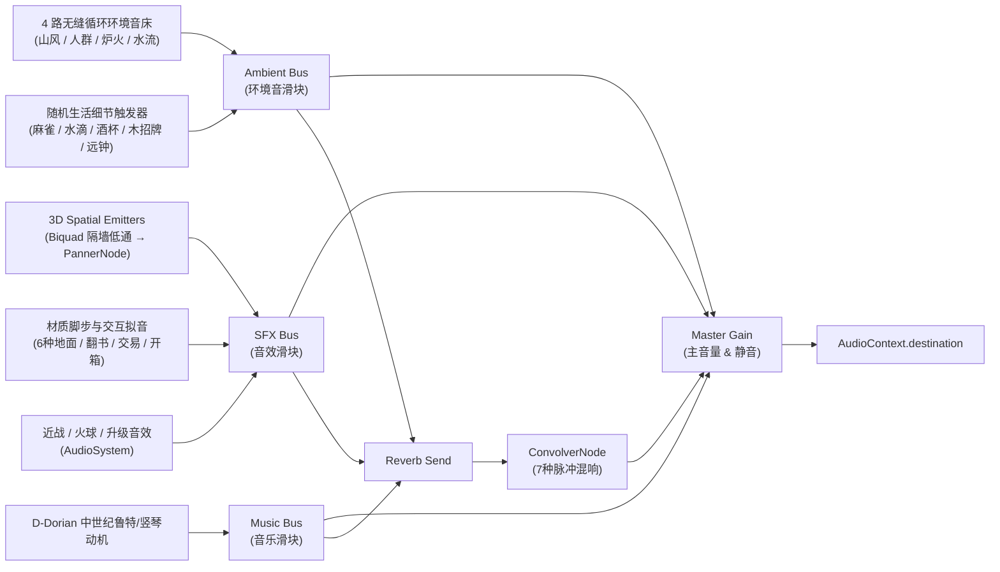

# Ashenhold V5 — 环境音、3D 空间声场与程序化材质音效文档 (`AUDIO_SYSTEM_V5.md`)

> **版权与授权合规声明（Licensing & Provenance）**
> 本项目 `Ashen March — 灰烬边境` V5 所使用的全部环境音床、3D 空间声源、脉冲卷积混响（Impulse Responses）、6 种地面脚步声及交互拟音（Foley SFX）**100% 由项目内原创 TypeScript WebAudio DSP 代码实时/离线缓存合成（CC0 / 自研原创代码）**，**零外部第三方受版权保护的音频样本（`.mp3` / `.wav` / `.ogg`）**，可安全用于公开仓库、GitHub Pages 在线试玩及任何商业/开源分发。

---

## 1. 模块架构与总线拓扑（WebAudio Bus Graph）

音频子系统拆分为四个解耦模块：
1. [`src/audio/AmbientAudioManager.ts`](file:///home/antigravity/xiezhengtao13-sys/ashen-march/src/audio/AmbientAudioManager.ts)：管理 `AudioContext` 生命周期、四路独立音量总线、9 大声学区域平滑交叉淡入淡出（Crossfade）及 7 种空间卷积混响。
2. [`src/audio/SpatialAudioEmitter.ts`](file:///home/antigravity/xiezhengtao13-sys/ashen-march/src/audio/SpatialAudioEmitter.ts)：管理 12 处世界 3D 定点声源（`PannerNode`），独立于视觉箱庭裁剪，支持跨 Portal 隔墙低通滤波遮挡（Acoustic Wall Occlusion）。
3. [`src/audio/FootstepAudioSystem.ts`](file:///home/antigravity/xiezhengtao13-sys/ashen-march/src/audio/FootstepAudioSystem.ts)：基于玩家脚下实时材质采样（[`getCitySurfaceMaterial`](file:///home/antigravity/xiezhengtao13-sys/ashen-march/src/world/city/CityRoadNetwork.ts)）驱动速度自适应脚步声、跳跃/落地声及开门、翻书、开箱、交易、穿戴装备音效。
4. [`src/data/cityAudioZones.json`](file:///home/antigravity/xiezhengtao13-sys/ashen-march/src/data/cityAudioZones.json)：数据驱动的声学区域、室内声学覆盖包围盒与 3D 声源配置表。

---

## 2. 九大声学区域与室内混响切换

| 声学区 ID | 对应区域 / 覆盖条件 | 主导声景构成 | 脉冲卷积混响 (`Convolver`) |
| :--- | :--- | :--- | :--- |
| `amb_gate_barbican` | `Cell 01` 南城门与曲轴瓮城 | 谷口穿山粉红噪声风床、微弱旗帜猎猎与高地林鸟 | `outdoor_courtyard` (`0.65s`) |
| `amb_trade_street` | `Cell 02` 曲折贸易街 | 窄石巷穿堂微风、木质店招摇晃吱呀声、市井低语 | `outdoor_alley` (`0.88s`) |
| `amb_tavern_interior` | `Cell 02` 余烬酒馆室内覆盖盒 | 阻隔室外风声，突显壁炉柴火温暖底噪、酒杯轻碰与交谈 | `timber_tavern` (`0.52s` 暖木阻尼) |
| `amb_market_plaza` | `Cell 03` 中央拱廊市集 | 熙攘人群共振峰滤波底噪、摊位帆布微响 | `outdoor_courtyard` (`0.65s`) |
| `amb_artisan_quarter` | `Cell 04` 西侧工匠区 | 锻炉鼓风热浪底噪，叠加 3D 铁砧锤击与锯木工坊声 | `semi_open_yard` (`0.76s`) |
| `amb_residential` | `Cell 05` 东侧居民高地 | 安静高地微风、白昼麻雀双音鸣叫、木构轻响 | `outdoor_alley` (`0.88s`) |
| `amb_temple_heights` | `Cell 06` 圣堂高地及大圣堂室内 | 清冷山风与庄严泛音；进入圣堂大殿自动切换长混响 | `cathedral_stone` (`2.15s` 石拱长尾) |
| `amb_lord_castle` | `Cell 07` 领主城堡与议事大厅 | 山巅劲风、战旗拍打；进入议事大厅切换石厅混响 | `great_hall_stone` (`1.75s`) |
| `amb_undercroft` | `Cell 08` 地下暗渠与秘库 | 低频暗渠水流共鸣、高频随机拱顶水滴落水回声 | `damp_undercroft_tunnel` (`1.90s`) |

---

## 3. 3D 空间声源与跨墙低通滤波遮挡（Portal-Aware Occlusion）

`SpatialAudioSystem` 不会随视觉 Cell 隐藏而粗暴切断声音，而是调用 [`CityPortalVisibility.computeAcousticOcclusion`](file:///home/antigravity/xiezhengtao13-sys/ashen-march/src/world/city/CityPortalVisibility.ts) 计算玩家与声源经过最近连通门洞（Portal）的声程绕射比：
- **直视无遮挡（`occlusion = 0.0`）**：`BiquadFilterNode` 低通截止频率保持 **`16,000 Hz`**，金属铁砧锤击（`1180 / 2510 / 3840 Hz` 非谐波泛音）清脆明亮。
- **隔墙 / 转角遮挡（`occlusion ≈ 0.75–0.92`）**：截止频率平滑下潜至 **`670–950 Hz`** 并衰减直达声增益——当玩家位于中央市集（`Cell 03`）西拱廊外时，能真实听见墙后工匠区（`Cell 04`）传来的闷沉打铁声，引导玩家循声穿过西拱门发现铁砧大锻坊。
- **可交互钟楼大钟（`emit_cathedral_bell`）**：攀爬至 `Cell 06` 圣堂钟楼顶（`+24.2m`）按 `[E]` 敲响大钟，将触发 `88m` 传播半径的四偏音青铜钟声回荡全城。

---

## 4. 六种地面材质脚步与生命周期保护

- **地面分类与合成特征**：
  1. `stone_flagstone`（石板街/广场/城墙）：`192 Hz` 鞋跟低频 + `1850 Hz` 石面清脆敲击。
  2. `stone_stair`（石质阶梯）：`168 Hz` 较重踏阶共鸣 + 石棱摩擦。
  3. `wood_plank`（酒馆/商行/民居楼板与木栈道）：`148 Hz` 三角波空腔木板共鸣 + `880 Hz` 木面踏音。
  4. `dirt`（土路/路肩碎石）：`2350 Hz` 宽带砂砾摩擦包络。
  5. `grass`（城外草坡）：`3400 Hz` 轻柔草叶拂动 + 低频软土声。
  6. `shallow_water`（市集喷泉池/暗渠浅水沟）：`3100 Hz` 水花飞溅散射噪声。
- **浏览器合规与防泄漏**：
  - 首次鼠标点击或按键自动解锁 `AudioContext`（无控制台 Autoplay 报错）。
  - 标签页隐藏（`visibilitychange`）自动 `suspend()`，切回自动恢复。
  - 超出 `maxDistance` 的连续 3D 声源立即 `stop()` 并 `disconnect()`，保证活动 `AudioNode` 数量恒定可控（通常 `14–30` 个节点）。
  - `[Esc]` 系统菜单内提供 **主音量 / 环境音 / 音效 / 音乐** 四路独立滑块并持久化至 `localStorage`。
