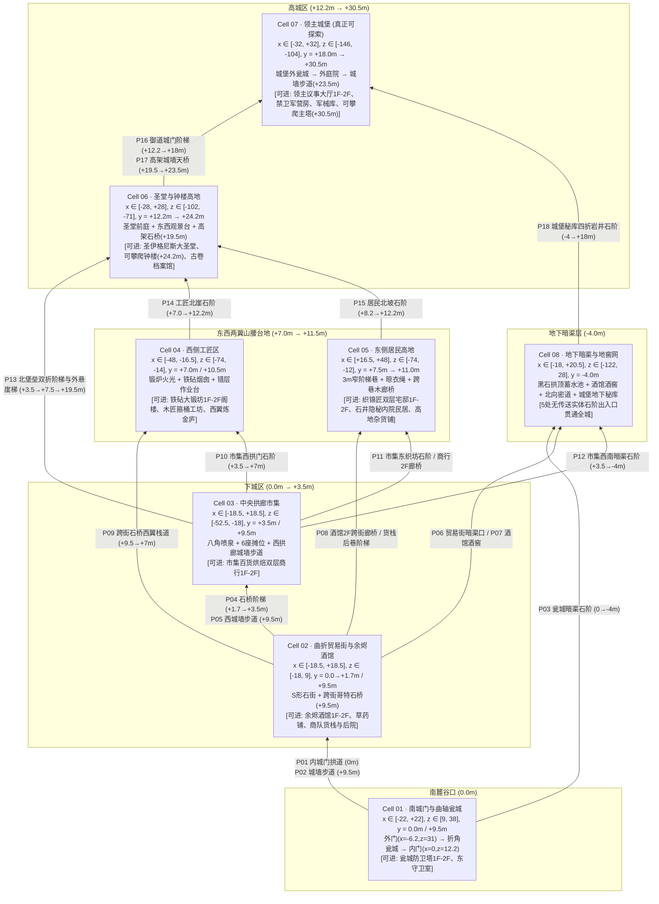

# Ashenhold V5 — 互联箱庭山城完整关卡蓝图 (`CITY_BLUEPRINT_V5.md`)

> **分支**：`feature/ashenhold-interconnected-city-v5`（基于 `feature/ashenhold-visual-polish-v4`）
> **美术基线**：完整继承 V4 雕刻级 BMesh 石砌资产、1024px HBAO 打包 ORM PBR 材质库与自然日光/暖火对比光照。
> **核心目标**：将灰烬城（Ashenhold）从高品质垂直切片扩展为**八大高密度互联箱庭（Cell 01 – Cell 08）**组成的完整西幻山城，实现短视距高墙围合、无传送多路线/多层建筑穿行、Cell & Portal 动态可见性裁剪、程序化 WebAudio 空间声场与鲜活 RPG 主城体验。

---

## 1. 城市总体平面图（Top-Down 2D Plan）

坐标系约定（Three.js 世界空间）：
- **`+X` = 东（East）**，**`-X` = 西（West）**
- **`-Z` = 北（North，上山方向）**，**`+Z` = 南（South，城门外方向）**
- **`+Y` = 海拔高度（Elevation）**，跨度从地下暗渠 **`-4.0m`** 直达领主主堡塔冠 **`+30.5m`**（总可步行垂直高差 **`34.5m`**）。



---

## 2. 城市南北向与东西向高度剖面图（Vertical Cross-Sections）

### 2.1 南北中轴与地下剖面（N–S Elevation Profile）

```text
海拔 (Y)
+30.5m ──                                                         [Cell 07 主堡瞭望塔冠]
+24.2m ──                                        [Cell 06 钟楼顶]       │ (室内盘旋石阶)
+21.0m ──                                            │            [Cell 07 领主议事大厅 1F/2F(+25.5m)]
+19.5m ──                              [北瞭望塔台]═══╪═(高架天桥)══►[城堡外城墙步道 +23.5m]
+18.0m ──                                   │        │            [Cell 07 城堡外庭院·营房·军械库]
+12.2m ──                                   │   [Cell 06 圣堂前庭·大圣堂·档案馆] ──┘ ▲
 +9.5m ──  [瓮城塔顶]══[南门步道]══[跨街石桥]═╪═[市集西城墙步道]                     │ (四折秘道岩井)
 +7.5m ──      │          │          │  [北堡垒平台]                                │
 +3.5m ──      │          │          └──[Cell 03 中央拱廊市集·喷泉]                 │
 +1.6m ──      │     [Cell 02 曲街·酒馆1F]                                         │
  0.0m ── [Cell 01 曲轴瓮城·双门]                                                   │
 -4.0m ══ [瓮城暗渠口]══[Cell 08 黑石蓄水暗渠 & 酒馆酒窖]══[北向密道]══[城堡地下秘库]═╝
          z=+36      z=+12      z=-5        z=-35      z=-65      z=-86        z=-118      z=-136
```

### 2.2 中段东西向剖面（E–W Cross-Section at `z ≈ -36m`）

```text
  西断崖岩壁 (-52m)        Cell 04 西侧工匠区         Cell 03 中央市集         Cell 05 东侧居民高地       东断崖岩壁 (+52m)
     ▲ +22m               (+7.0m 台地 / +10.5m 阁楼)     (+3.5m 广场)          (+7.5m → +11.0m 阶梯巷)         ▲ +23m
     │  ┌──────────────┐                            │                       ┌──────────────┐  │
     ├──┤ 铁砧大锻坊2F ├──(跨墙木栈道 +9.5m)──►[西拱廊步道]                 │ 居民上层平台 ├──┤
     │  │ 铁砧大锻坊1F │◄─(西拱门石阶)─┐            │   [百货商行2F]─(廊桥)─► 织锦匠宅邸2F │  │
     │  └──────────────┘               └────────[八角喷泉]─[百货商行1F]◄(石阶)─ 织锦匠宅邸1F │  │
     │                                       [西南暗渠阶梯]                 └──────────────┘  │
     │                                       [Cell 08 -4.0m]                                  │
```

---

## 3. 八大箱庭（Cell 01 – Cell 08）边界、视距控制与渲染预算

每个箱庭均由 **`10–18m` 高厚重石墙、2–3 层建筑立面、折角门洞或倾斜地层断崖** 严密围合。平地街道常规直视距离控制在 **`18–52m`**，绝无“进门一眼望穿全城”或空旷平地边缘。

| Cell ID | 区域名称 | 3D AABB 边界 (`[minX,minY,minZ] → [maxX,maxY,maxZ]`) | 基准标高 | 视距阻断设计 | 单箱庭主通道预算 (`Main Pass`) |
| :--- | :--- | :--- | :--- | :--- | :--- |
| `cell_01_barbican_gate` | 南城门与瓮城 | `[-22, -1.0, 8.8] → [22, 22.0, 38.0]` | `0.0m` / `+9.5m` | **曲轴双门**：外门(`x=-6.2, z=31`)正对西卫塔厚墙，必须在瓮城内向东折转 90° 再向北穿过内门(`x=0, z=12.2`) | `≤ 220 DC` / `≤ 240k Tris` |
| `cell_02_trade_street` | 贸易街与余烬酒馆 | `[-18.5, -0.5, -18.0] → [18.5, 17.0, 9.2]` | `0.0→+1.7m` / `+9.5m` | S 形弯曲石街 + 两侧 2–3 层楼体 + `z=-14.5` 跨街哥特石桥阻断市集直视 | `≤ 230 DC` / `≤ 250k Tris` |
| `cell_03_market_plaza` | 中央拱廊市集 | `[-18.5, 2.5, -52.8] → [18.5, 18.0, -17.8]` | `+3.5m` / `+9.5m` | 四周西拱廊、东双层商行、南跨街石桥、北 `4m` 挡土堡垒墙合围成紧凑 `28×30m` 院落 | `≤ 250 DC` / `≤ 270k Tris` |
| `cell_04_artisan_quarter` | 西侧工匠区 | `[-49.0, 5.0, -74.5] → [-16.2, 22.0, -13.5]` | `+7.0m` / `+10.5m` | 西接陡峭断崖岩壁，东靠市集拱廊后墙，通过折角拱门进出 | `≤ 210 DC` / `≤ 220k Tris` |
| `cell_05_residential_heights` | 东侧居民高地 | `[16.2, 5.0, -74.5] → [49.0, 23.0, -11.5]` | `+7.5m` → `+11.0m` | `3.2m` 窄阶梯巷 + 三层悬挑木骨楼 + 东侧山体断崖遮挡 | `≤ 220 DC` / `≤ 230k Tris` |
| `cell_06_temple_acropolis` | 圣堂与钟楼高地 | `[-28.5, 7.0, -103.0] → [28.5, 28.0, -52.5]` | `+12.2m` → `+24.2m` | 圣堂围墙与北御道城门围合；仅在东西观景台及 `+24.2m` 钟楼顶激活远景 `Vista` | `≤ 240 DC` / `≤ 260k Tris` |
| `cell_07_lord_castle` | 领主城堡 | `[-33.0, 16.5, -147.0] → [33.0, 43.0, -102.5]` | `+18.0m` → `+30.5m` | 城堡外瓮城与 `16m` 高护墙分割高地，内含外庭院、军械库、营房与双层议事大厅 | `≤ 240 DC` / `≤ 260k Tris` |
| `cell_08_undercroft_cellars` | 地下暗渠与地窖 | `[-18.0, -5.8, -122.5] → [20.5, 3.6, 28.0]` | `-4.0m` | 纯地下石拱隧道，地表非井口附近 **100% 剔除**；地底仅渲染 `Cell 08` 及井口邻接箱庭 | `≤ 140 DC` / `≤ 150k Tris` |

---

## 4. Portal 连通图与路线矩阵（Portals & Interconnected Routes）

### 4.1 20 个空间门洞（Portals `P01` – `P20`）
详见数据配置 [`src/data/cityPortals.json`](file:///home/antigravity/xiezhengtao13-sys/ashen-march/src/data/cityPortals.json)：
- `P01`：`Cell 01 ↔ Cell 02` — 南内城门哥特拱道 `(0.0, 2.5, 12.2)`
- `P02`：`Cell 01 ↔ Cell 02` — 南门城墙步道与内侧卫兵石阶 `(-4.8, 9.5, 9.0)`
- `P03`：`Cell 01 ↔ Cell 08` — 瓮城西侧暗渠泄洪石阶 `(-12.5, -1.5, 21.5)`
- `P04`：`Cell 02 ↔ Cell 03` — 跨街石桥下主街阶梯 `(0.0, 3.0, -16.5)`
- `P05`：`Cell 02 ↔ Cell 03` — 西城墙女墙步道 `(-13.5, 9.5, -17.8)`
- `P06`：`Cell 02 ↔ Cell 08` — 贸易街西侧暗渠拱门 `(-4.2, 1.4, -7.0)`
- `P07`：`Cell 02 ↔ Cell 08` — 余烬酒馆后院酒窖木门石阶 `(12.6, 0.4, 3.5)`
- `P08`：`Cell 02 ↔ Cell 05` — 跨街石桥东端/酒馆二楼通往居民高地廊桥 `(15.5, 9.5, -14.5)`
- `P09`：`Cell 02 ↔ Cell 05` — 商队货栈后巷东登石阶 `(15.5, 4.2, -6.0)`
- `P10`：`Cell 02 ↔ Cell 04` — 跨街石桥西端通往锻坊二楼木栈道 `(-16.2, 9.5, -14.5)`
- `P11`：`Cell 03 ↔ Cell 04` — 中央市集西拱廊第三开间锻坊石阶 `(-16.2, 5.2, -35.0)`
- `P12`：`Cell 03 ↔ Cell 05` — 中央市集东侧织坊阶梯拱门 `(16.2, 5.5, -35.0)`
- `P13`：`Cell 03 ↔ Cell 05` — 市集百货烘焙商行 2F 穿楼东阳台 `(17.2, 7.5, -26.5)`
- `P14`：`Cell 03 ↔ Cell 08` — 中央市集西南角暗渠石阶井口 `(-9.6, 3.5, -36.5)`
- `P15`：`Cell 03 ↔ Cell 06` — 市集北堡垒双折石阶平台 `(0.0, 7.5, -52.5)`
- `P16`：`Cell 04 ↔ Cell 06` — 西侧工匠区北崖石阶 `(-21.0, 9.8, -68.0)`
- `P17`：`Cell 05 ↔ Cell 06` — 东侧居民高地北坡石阶 `(21.0, 9.8, -68.0)`
- `P18`：`Cell 06 ↔ Cell 07` — 圣堂北御道与城堡外瓮城大门 `(0.0, 18.0, -104.0)`
- `P19`：`Cell 06 ↔ Cell 07` — 瞭望塔顶/钟楼中廊至城堡外墙高架天桥 `(8.5, 19.5, -102.5)`
- `P20`：`Cell 08 ↔ Cell 07` — 城堡地下秘库至军械库四折岩井密道 `(15.0, 18.0, -118.5)`

### 4.2 六大必达路线与 ≥4 条完整环形回路
1. **中轴主干线**：`Cell 01` 外门 → 瓮城 → 内门 → `Cell 02` 贸易街 → `Cell 03` 中央市集 → `Cell 06` 圣堂高地 → `Cell 07` 领主城堡议事大厅。
2. **西翼工匠线**：`Cell 03` 中央市集 → `P11` 西拱门石阶 → `Cell 04` 铁砧大锻坊与木工场 → `P16` 工匠北崖石阶 → `Cell 06` 圣堂前庭。
3. **东翼居民线**：`Cell 03` 中央市集（或穿行百货商行 1F→2F！）→ `Cell 05` 阶梯巷与织锦匠双层宅邸 → `P17` 居民北坡石阶 → `Cell 06` 圣堂前庭。
4. **下城暗渠捷径**：`Cell 01` 瓮城 / `Cell 02` 贸易街（或酒馆酒窖）→ `Cell 08` 地下暗渠 (`-4.0m`) → `P14` 市集西南阶梯 → `Cell 03` 中央市集。
5. **跨城潜入密道**：`Cell 08` 地下暗渠北段 & 城堡地下秘库 (`-4.0m`) ↔ `P20` 四折岩井石阶 ↔ `Cell 07` 城堡军械库 (`+18.0m`)。
6. **高空城墙环道**：`Cell 01` 瓮城防卫塔 (`0→+9.5m`) → 南门城墙步道 → `Cell 02` 跨街石桥 (`+9.5m`) → `Cell 03` 西拱廊女墙 → 悬崖瞭望塔顶 (`+19.5m`) → `Cell 06` 钟楼中廊与高架天桥 (`+19.5m`) → `Cell 07` 城堡护墙步道 (`+23.5m`)。

---

## 5. 可进入建筑与多层穿行清单（14 处真实室内与工坊空间）

| # | 建筑名称 | 所属 Cell | 层数与穿行能力 | 室内结构与交互内容 |
| :---: | :--- | :---: | :--- | :--- |
| 1 | **瓮城西防卫塔楼** | `Cell 01` | **2 层穿行** (`0m → +4.8m → +9.5m`) | 1F 卫戍备战室、武器架；室内盘旋石阶直通 `+9.5m` 瓮城与南门城墙步道 |
| 2 | **南门东侧守卫室** | `Cell 01` | 1 层完整室内 | 石砌值勤桌、床铺、入城通关名册（可阅读文献） |
| 3 | **余烬与酒杯酒馆** | `Cell 02` | **2 层穿行** (`+1.6m → +5.2m → +9.5m`) | 1F 壁炉吧台与酒客；室内橡木梯上 2F 客房阳台，北门连通跨街石桥与东居民区 |
| 4 | **贸易街草药铺** | `Cell 02` | 1 层完整室内 | 蒸馏器柜台、药材架、炼金笔记与药剂补给 |
| 5 | **商队货栈与后院** | `Cell 02` | 半开放室内 + 围合院 | 货箱吊装木架、通往 `Cell 08` **酒馆酒窖** 的下行石阶及通往 `Cell 05` 的后巷捷径 |
| 6 | **市集百货与烘焙双层商行** | `Cell 03` | **2 层穿行** (`+3.5m → +7.5m`) | 1F 烤炉与香料柜台；室内木梯上 2F 账房画廊，东门直出 `Cell 05` 居民高地 |
| 7 | **铁砧大锻坊** | `Cell 04` | **2 层穿行** (`+7.0m → +10.5m`) | 1F 熊熊锻炉、铁砧、淬火槽、铁匠大师布伦南商铺；2F 阁楼木栈道直通西城墙步道 |
| 8 | **橡木箍桶与木匠工坊** | `Cell 04` | 半开放工坊院落 | 锯木台、半成品木桶、车轮架、劳作木匠 NPC |
| 9 | **西翼炼金草药庐** | `Cell 04` | 1 层完整室内 | 药柜、研钵台、草药师配方卷轴 |
| 10 | **织锦匠双层宅邸** | `Cell 05` | **2 层穿行** (`+7.5m → +11.0m`) | 下巷进 1F 织机起居室；上 2F 卧室跨过巷上木廊桥直达居民上层台地 |
| 11 | **石井隐秘内院民居** | `Cell 05` | 隐秘院落 + 1F 住宅 | 穿过低矮石拱发现古井小院，室内藏有居民日记与传家护符宝箱 |
| 12 | **圣伊格尼斯大圣堂 & 钟楼** | `Cell 06` | **大殿 + 4 层钟楼** (`+12.2m → +24.2m`) | 肋架拱顶、石柱、长椅、烛台、圣坛；钟楼可一路爬至 `+24.2m` 敲响青铜大钟俯瞰全城 |
| 13 | **灰烬行会与古卷档案馆** | `Cell 06` | 1 层高挑室内 | 双排橡木书架、阅览台、首席档案官支线任务与暗渠密道考据文献 |
| 14 | **领主议事大厅 + 营房 + 军械库** | `Cell 07` | **2 层大厅 + 攀爬主塔** (`+18m → +30.5m`) | 议事大厅王座台与 2F 走廊连城墙、禁卫营房、军械库（内含直通 `Cell 08` 的岩井密道） |

---

## 6. 区域环境声场与空间声源规划（Audio Architecture）

全部音频采用 **100% 原创程序化 WebAudio 合成与离线缓存脉冲卷积混响（CC0 / 自研代码，零外部侵权采样）**：

| 声学区 ID | 绑定 Cell | 环境底噪 (`Ambient Bed`) | 3D 空间声源 (`SpatialAudioEmitter`) | 混响脉冲 (`Convolver`) |
| :--- | :---: | :--- | :--- | :--- |
| `amb_gate_barbican` | `Cell 01` | 谷口山风、旗帜猎猎、远方溪谷鸟鸣 | 火盆燃烧声、城门铁链微响、卫兵巡逻甲叶声 | `outdoor_courtyard` |
| `amb_trade_street` | `Cell 02` | 窄巷穿堂微风、木招牌摇晃、马车木轮余音 | 酒馆门窗漏出的暖意人声与鲁特琴泛音、铁匠远景闷响（隔墙低通滤波） | `outdoor_alley` |
| `amb_tavern_interior` | `Cell 02` 室内 | 炉火温暖噼啪、酒杯轻碰、低语交谈 | 1F 壁炉近距柴火、酒桶滴酒声 | `timber_tavern` |
| `amb_market_plaza` | `Cell 03` | 市集人群轻声熙攘、布篷受风声 | 中央八角喷泉潺潺流水、摊主吆喝提示音 | `outdoor_courtyard` |
| `amb_artisan_quarter` | `Cell 04` | 锻炉风箱呼啸、炭火热浪 | **铁砧锤击金属叮当声**、淬火蒸汽嘶鸣、木工锯木声 | `semi_open_yard` |
| `amb_residential` | `Cell 05` | 安静高地微风、麻雀清脆鸣叫、晾衣绳轻摆 | 古井水声、织机木梭规律轻响 | `outdoor_alley` |
| `amb_temple_heights` | `Cell 06` | 高山清冷风声、圣堂静谧庄严空气感 | **钟楼青铜大钟悠远泛音钟声**、圣坛烛火微响 | `cathedral_stone` (室内) / `high_cliff` (室外) |
| `amb_lord_castle` | `Cell 07` | 凛冽山巅高空风声、战旗拍打、甲胄巡逻感 | 王座大厅巨型火塘燃烧、城垛火盆 | `great_hall_stone` / `high_cliff` |
| `amb_undercroft` | `Cell 08` | 幽深封闭低频暗渠水流共鸣 | **拱顶随机水滴落水回声**、铁栅水流声、火把油脂声 | `damp_undercroft_tunnel` |
